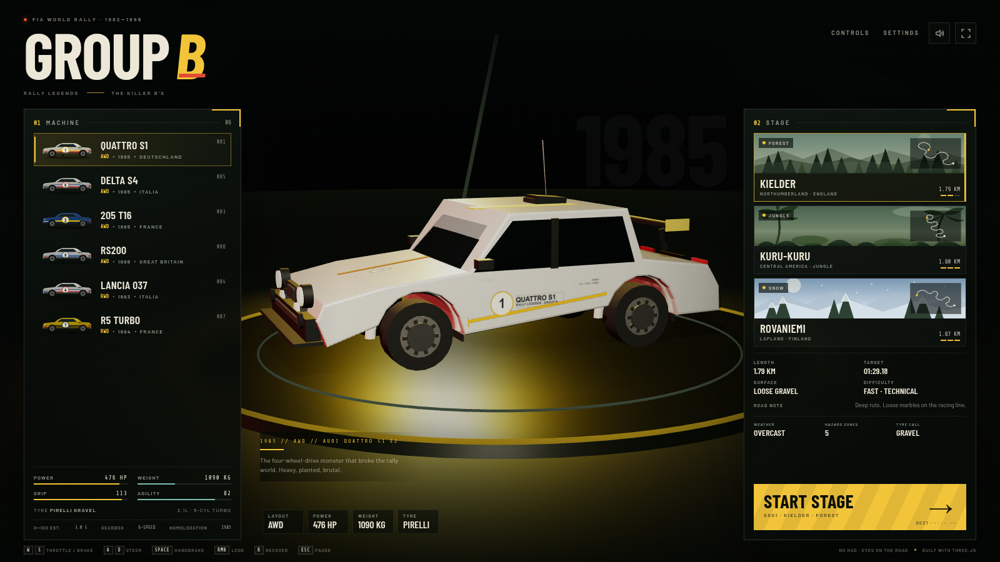
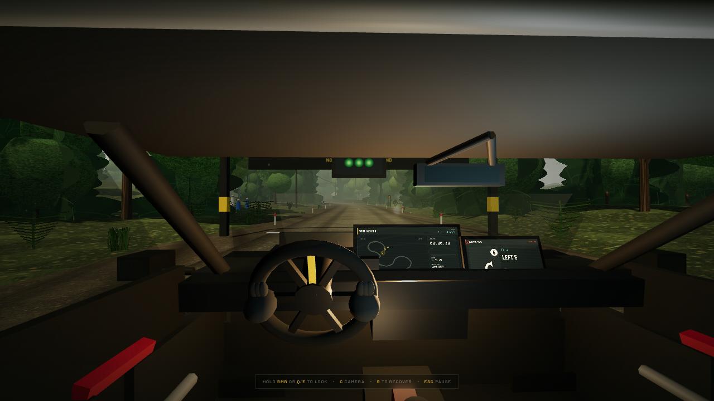
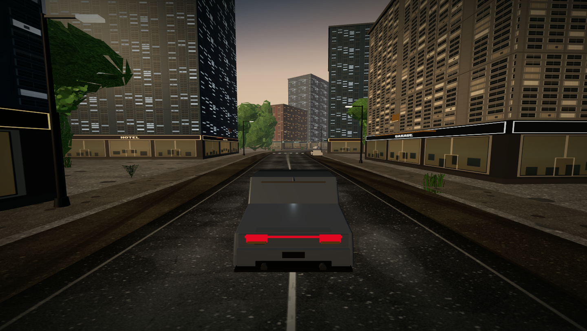
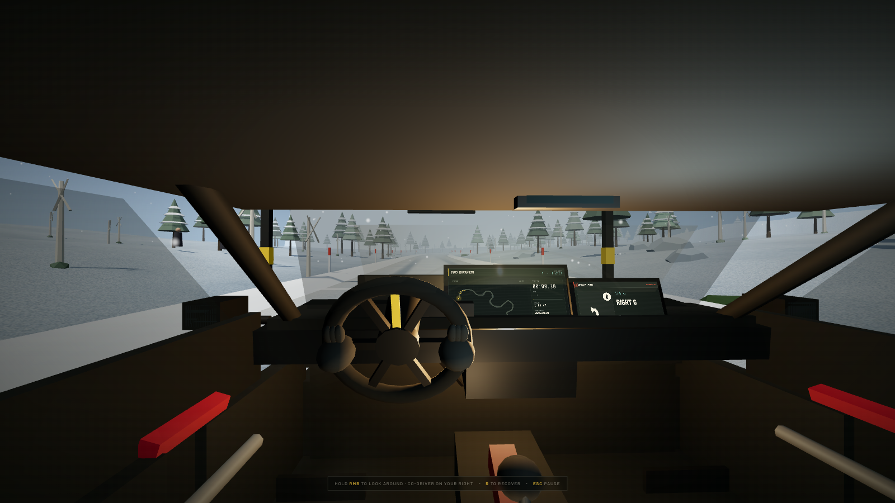

# GROUP B — RALLY LEGENDS

A 3D first-person driving game built with Three.js and vanilla JavaScript. It began as a Group B rally tribute and has grown into a broader autosim: eleven authored stages across eleven environments, nineteen cars from period rally monsters to modern Rally1 and road sports cars, five everyday city cars, an infinite branching road network, open off-road terrain, solid scenery and destructible trees, a physical cockpit with a working trip-computer map, co-driver pacenotes, and a surface-aware driving model.



## Run it

ES modules need an HTTP server, so opening `index.html` directly will not work.

```bash
./run.sh
# or
npm start
```

Then open <http://localhost:8080/>. The server binds to `127.0.0.1` by
default. For explicit trusted-LAN debugging use `HOST=0.0.0.0 ./run.sh` or
`npm run serve:lan`; the Python stdlib server is a development tool, not a
production web server. The game is desktop-first and supports keyboard or
gamepad.

## Development

```bash
npm run check    # syntax-check every JS module
npm test         # Node built-in unit tests
npm run lint     # alias for check
```

For automation and profiling, append `?debug=1`. That exposes the frozen
`window.__RALLY` API (`start`, `state`, `pause`, `resume`, `quit`, `camera`)
and `window.__GAME`; normal URLs expose neither.

## Documentation

- [`docs/architecture/`](docs/architecture/) — project structure, runtime,
  procedural world, physics, rendering/audio, security/deployment and testing.
- [`SECURITY.md`](SECURITY.md) — reporting and hardening summary.
- [`THIRD_PARTY_NOTICES.md`](THIRD_PARTY_NOTICES.md) — vendored Three.js
  provenance and update procedure.
- [`group_b_rally_QA_security_audit.md`](group_b_rally_QA_security_audit.md) —
  original audit; the fix map is
  [`docs/architecture/08-audit-fix-map.md`](docs/architecture/08-audit-fix-map.md).

## The game

### Eleven stages across eleven environments
- **KIELDER** — a fast, blind-crested forest stage in Northumberland. Loose gravel and mud.
- **KURU-KURU** — a tight Central American jungle tunnel of wet mud, standing water and roots, with rain.
- **ROVANIEMI** — Lapland's snowbanks and sweepers, with glare ice and snowfall.
- **HONSHU TOUGE** — a narrow cedar-lined Japanese mountain pass. Wet asphalt, switchbacks, guardrails and mist.
- **URAL TAIGA** — wide, fast Russian trail through birch alleys. Cracked asphalt, long straights and blind crests.
- **GREAT RIFT** — a red-dirt Kenyan safari trail with acacia trees, big crests and open dust.
- **RIVIERA CORNICHE** — warm Mediterranean coastal tarmac. Tight walls, sea air and a long drop.
- **COL DE L'ISERAN** — high alpine asphalt. Cold switchbacks, stone parapets and stacked hairpins.
- **EIFEL RING** — damp German forest tarmac. Long fourth-gear crests and blind, off-camber entries.
- **TOSCANA STRADA** — sunlit hill tarmac through cypress and stone farms. Fast flowing sweeps at dusk.
- **MERIDIAN CITY** — a wide downtown boulevard loop through glass towers, shopfronts, zebra crossings and street parking. Smooth city asphalt, strong brakes and clean sight lines.

Every authored stage route is generated from a Catmull-Rom spline with its own geometry, terrain, tree/rock scatter, hazards, pacenotes and weather. ENDLESS routes use a dedicated forward-progressing procedural generator. No external models or textures are used.

### Biome generation
The regions no longer share one generic forest. Each biome owns its terrain profile, road surface, tree and understory mix, roadside furniture, palette and atmosphere:
- **KIELDER** — rolling Northumberland banks, dense pine/oak canopy, ferns, stone walls and telegraph wires over loose gravel.
- **KURU-KURU** — steep jungle ridges, palms, banana leaves, hanging vines, reeds and standing water over wet mud.
- **ROVANIEMI** — open Lapland fells, wind-packed snow, drifts, exposed rock and sparse snow-laden spruce.
- **HONSHU TOUGE** — a genuine mountain shelf: a cliff/retaining wall on the uphill side, guardrail and valley drop on the other, cedar trunks and asphalt lane markings.
- **URAL TAIGA** — flat, wide taiga with white birch alleys, utility poles, dry grass and cracked asphalt.
- **GREAT RIFT** — open red-earth savannah with acacias, baobabs, dry grass, termite mounds and dust.
- **RIVIERA** — dry Mediterranean scrub, umbrella pines, warm limestone and exposed coastal tarmac.
- **ALPINE** — alpine meadow, exposed limestone, snow-capped skyline and cold mountain asphalt.
- **EIFEL** — lush oak/birch woodland, damp shade and dark forest tarmac.
- **TUSCANY** — dry golden grass, cypress, olive tones and sun-bleached hill tarmac.
- **MERIDIAN CITY** — a dense street grid of procedural facades, lit shop windows, kerbs, parking bays, street lamps, crossings, parked cars and a central plaza with a clock tower. Buildings are solid and the pavement is raised, so the city reads as a real place rather than a painted backdrop.


### ENDLESS mode
Pick any stage, flip the menu switch from **STAGE** to **ENDLESS**, and the road keeps generating ahead of you forever.

- A procedural route generator builds corners, hairpins, straights, elevation changes and crests from the selected region's own character (tight touge, fast taiga, open safari, icy Lapland, etc.).
- The main route grows a **branching side-road network**. Junctions fork left or right every few hundred metres; some branches wander away and dead-end, others curve back and rejoin the main road further ahead. Every branch is fully drivable with its own surface query, shoulders, marker posts and grip. Branch geometry is validated against the main road, existing side roads and itself, so roads no longer draw through each other. Junction mouths are filled with a tapered road apron that blends the side-road crown into the main carriageway, so there is no open wedge, lip or disconnected edge at either end of a branch.
- Road, shoulder, snow bank, scenery, posts and hazard surfaces are streamed in ~200 m chunks and the chunks behind you are disposed, so geometry and draw calls stay flat. Side-road topology and meshes are likewise built, disposed and pruned as you move.
- Terrain is a separate **2D tile grid streamed around the car**, not a ribbon tied to the road. Ground therefore exists in every direction, including areas with no road at all. Dense tiles load around the player, distant tiles are disposed, and the grid follows you when you drive far off-road. There is no barrier beside the road any more: you can cross the verge, drive through the trees, explore the hillside and rejoin wherever you like. Endless terrain is smoothed across neighbouring route cross-sections, with lower-frequency micro-relief and a blended mountain-side profile, so streamed hills no longer arrive as sharp sawteeth or vertical seams.
- Hazards, pacenotes and the co-driver keep being generated with the road. The trip-computer map switches to a live local section instead of trying to draw a shrinking whole route.
- The timer keeps running, there is no finish gantry, and your furthest distance is stored per stage and car. Quit from the pause menu when you have had enough.
- Streaming works on all eleven environments, including the city. City side roads still stream buildings, pavements, street furniture and parked cars with their chunks.

### Cars across eras
| Car | Layout | Power | Weight | Character |
|---|---|---|---|---|
| Audi Quattro S1 E2 | AWD | 476 hp | 1090 kg | Heavy, planted, five-cylinder turbo |
| Lancia Delta S4 | AWD | 480 hp | 890 kg | Light, twin-charged, savage |
| Peugeot 205 T16 Evo 2 | AWD | 499 hp | 910 kg | Compact and agile |
| Ford RS200 | AWD | 450 hp | 1050 kg | Balanced mid-engine machine |
| Lancia 037 Rally | RWD | 325 hp | 960 kg | Supercharged, no safety net |
| Renault 5 Turbo 2 | RWD | 350 hp | 970 kg | Short-wheelbase pocket rocket |
| Toyota GR Yaris Rally1 | AWD | 380 hp | 1230 kg | Modern hybrid rally hardware, huge grip |
| Skoda Fabia RS Rally2 | AWD | 289 hp | 1230 kg | Friendly customer rally benchmark |
| BMW M3 E30 | RWD | 235 hp | 1200 kg | Linear, balanced touring-car icon |
| Porsche 911 Carrera RS 2.7 | RWD | 210 hp | 975 kg | Light, rear-engined, alive |
| Alpine A110 S | RWD | 292 hp | 1114 kg | Featherweight modern sports car |
| Mitsubishi Lancer Evo VI | AWD | 280 hp | 1365 kg | Heavy, planted Group A weapon |
| Ford Escort RS1800 Mk2 | RWD | 250 hp | 1000 kg | Loud, light and precise |
| VW Golf GTI 16V Mk2 | FWD | 160 hp | 960 kg | Eager front-drive hot hatch |
| Mercedes-Benz E 220 d | RWD | 197 hp | 1780 kg | Quiet executive saloon, ABS and stability control |
| BMW 530i xDrive | AWD | 248 hp | 1785 kg | Sharp everyday saloon with immediate steering |
| Volvo XC90 B5 AWD | AWD | 250 hp | 2090 kg | Heavy, calm SUV with a high view |
| Toyota Camry Hybrid | FWD | 218 hp | 1605 kg | Soft, roomy, unflappable city hybrid |
| VW Tiguan 2.0 TSI | AWD | 190 hp | 1740 kg | Compact SUV with light controls and a settled ride |

### Cockpit and dash
- Four camera views — **cockpit**, bonnet, chase and bumper — cycled with **C**, the pad's **LB** or the on-screen **CAM** button.
- First-person driver's-eye view with a 3D co-driver sitting to your right. Modern cars use a road-car cockpit with a soft-touch dash, digital instrument cluster, centre navigation display, ambient trim and a passenger holding a phone.
- Holding the **right mouse button** (or right stick) lets you look around at him, the side windows and the cabin.
- A real center-dash **trip-computer screen** displays the stage map, car marker, timer, best time, gear/speed, surface, grip level, road status and radio state. In ENDLESS mode the local map also draws the side-road forks.
- A second physical **co-driver screen** shows large directional arrows, severity numbers, distance, "tightens/opens" modifiers, the next note, current surface/grip and upcoming hazards.
- Steering wheel, hands, gear lever and handbrake animate. Rally interiors have a roll cage, harnesses, screens, wipers, mirrors and a helmeted co-driver; modern interiors swap these for a soft-touch road-car cabin, digital cluster and a passenger.
- No floating map or timer HUD. The only overlay in normal driving is a small controls hint that fades away.





### Weather and time of day
Every stage can be run in any combination of conditions. Both are selectable from the menu strip or in Settings:

- **Weather** — clear, overcast, rain, storm, snow and fog. Each changes sky and fog colour, sun strength, surface grip, spray/dust, wipers, headlights and the wet sheen on the road. Storms add lightning flashes and thunder.
- **Time** — dawn, day, dusk and night. Dawn/dusk grade the palette warm and put the sun on the horizon; night brings stars, a moon, fireflies and working headlights with light pools on the road.
- **Auto** keeps each stage's authored default look; pick dawn, dusk or night for a different mood.

### Driving model
- **DRIVING model selector** in the main menu (and Settings): **REALISTIC** is the default simulation-focused model with progressive breakaway, less artificial yaw damping, a grippier front axle and a rear axle that can be rotated with throttle, weight transfer or the handbrake. **ASSISTED** keeps the original forgiving grip floor and stronger electronic stabilisation for casual driving. The setting applies instantly and is saved.
- Four-wheel vehicle dynamics: every tyre has its own ground contact, suspension travel, normal load, longitudinal demand, spin/lock state and lateral slip force. The old bicycle model is gone; the body is balanced by the four contact patches.
- Steering has a speed-sensitive lock, a real rack rate, Ackermann front-wheel angles and self-centring return. The car asks for a slip angle rather than snapping to a yaw rate, and the tyre curve now builds force much earlier in the slip range, so small inputs actually bite.
- Longitudinal load transfer under acceleration and braking changes each wheel's grip. Lateral load transfer is modelled per side with a stability floor. Brake balance follows the dynamic front/rear load, so threshold braking is strong but the rear stays settled; locking the brakes costs steering and leaves lock-up marks.
- The terrain under all four wheels is sampled independently. Front/rear height differences and left/right height differences feed real gravity along the slope and across it, and the body pitch/roll is fitted to the contact plane instead of the road tangent. A car on a steep side-slope slides; a wall steeper than the climb limit blocks the car instead of letting it drive up a vertical face. The asphalt edge is blended across a 1.1 m shoulder ramp, so rejoining the road no longer hits an invisible step or blocks the car at the lip.
- A torque-curve engine, multi-speed automatic gearbox, clutch-cut shifts, engine braking, turbo spool and aero drag make acceleration and coasting speed-dependent. Wheels can spin or lock and the combined-slip tyre model reduces cornering grip when you use the tyres for braking or traction.
- Weight, centre-of-mass position and drivetrain layout affect the balance: AWD launch and neutrality, RWD throttle-oversteer, FWD understeer.
- Each car has its own grip figure, brake coefficient and tyre package.
- Modern city cars add a second, convenience-focused setup on top of the same four-wheel model: quick power steering with extra low-speed lock, strong assisted brakes, ABS, traction control and electronic stability control. The stability system trims yaw and sideways slide only when the car is actually slipping, so normal cornering stays natural. Handbrake input still overrides it.
- City cars are heavy and deliberately calm: in ASSISTED mode they brake from 100 km/h in roughly 15-16 m in the game's units, stay flat under load and resist spinning with a full steering input at motorway speed. REALISTIC mode reduces their stability intervention and lets the rear axle move under load. Rally cars keep their analogue, oversteer-friendly behaviour.
- Modern interiors are built as a separate cockpit specification: soft-touch dashboard, twin digital displays, ambient trim, leather seats, a flat-bottom wheel and a passenger instead of a helmeted rally co-driver. The dashboard map, trip computer and pacenote screen work exactly as before.
- Surface grip changes by biome, side-road surface and hazard patch: asphalt, broken asphalt, gravel, loose gravel, dirt, mud, water, roots, black ice, deep snow, wet tarmac, moss/leaves, ruts, rocks, sand, fesh-fesh, pavement and off-stage. A shared surface model changes lateral grip, longitudinal capacity, rolling drag, braking authority, body bump, dust/spray, tyre audio and off-road drag, so tarmac, gravel, mud and ice do not feel like the same road with a different colour.
- Handbrake locks the rear axle, cuts rear lateral grip and rotates the car while scrubbing speed.
- Turbo boost builds with lag; engine/induction/turbo audio follows the revs.
- The stage surface, ruts, snow banks, roadside markers, trees, boulders, city kerbs and buildings all affect the visual and physical route.
- Start/finish gantry posts are solid. Trees, rocks, logs and stumps are solid too; the corridor barrier beside the road has been removed so you can drive onto the verge and into the scenery.
- High-speed impacts break smaller objects. Trees, rocks, logs and stumps have their own break thresholds; a birch snaps at a much lower speed than an oak or a boulder. Debris is thrown, tumbles and fades, and the car keeps some momentum. Below the threshold, the object is immovable and stops or deflects the car.

### Pacenotes and co-driver
- Notes are generated from curvature, corner duration, tightening/opening rate, crests, jumps, straights and hazard patches.
- The co-driver calls notes as you approach them (toggle spoken voice in Settings).
- On-screen arrows and severity badges are drawn into the physical co-driver screen, with the road status/grip footer updating live.
- Radio activity is visualized on the screen, and the co-driver animates while calling.

### Vivid shaders
A custom post-processing stack is available in Settings under **Vivid shaders**:
- **VIVID** — gentle exposure lift, richer colour grade, bloom, sun haze, vignette, fine grain and chromatic edges.
- **CINEMATIC** — stronger contrast, teal shadows, warm highlights, heavier bloom and a filmic vignette.
- It is **off by default** and applies immediately from the Settings panel; normal rendering is untouched when it is off.

The stack is self-contained (`js/postfx.js`): a linear scene target, bright-pass bloom, separable blur and a final grading pass. It does not require an external post-processing package.

### Visual detail
- Trees are fully procedural with tapered multi-segment trunks, buttressed roots, visible limbs and forks, more organic multi-layer solid canopies, horizontal canopy sheets and denser billboard detail. Palms have scarified rings, root flares and a full frond skirt.
- Sky dome with colour-managed gradient, sun/moon discs, horizon glow, drifting procedural cloud cover and a star field at night.
- Biome-specific distant ridges (jagged snow peaks, jungle ridges, flat taiga, rift escarpment), telegraph poles and sagging wires, tyre stacks and hay bales on the outside of corners, sponsor boards, hazard warning signs and parked spectator cars.
- Roads are individually textured: loose gravel ruts, mud and standing water, packed snow with ice, damp asphalt with painted lines, cracked Russian asphalt with potholes, red safari dirt, the coastal/alpine/eifel/Tuscan tarmac variants and a clean city asphalt surface.
- The city is built from procedural architecture rather than a backdrop: facades with lit windows, shopfronts and awnings, raised kerbs and pavements, street lamps, traffic lights, zebra crossings, bins, benches and parked cars. A central plaza has a fountain, benches and a clock tower, and distant blocks form a real skyline. Buildings and parked cars are solid; the pavement is raised and drivable.
- Branching side roads use the same road materials and get their own shoulders and marker posts. Tapered junction aprons blend the branch deck into the main crown and close the wedge between the carriageways; junction-side posts are kept off the flare.
- Off-road terrain is generated as a square tile grid around the car, independent of road chunks; sparse trees and boulders are scattered into far tiles so the open world does not end at the verge. Endless terrain cross-sections are smoothed along the route and the mountain-side bias is blended, eliminating the sharp stair-stepped seams of the old streamed tiles.
- Skid marks are laid down under lock-up or handbrake slides; puddles and wet sheen appear when it rains.
- Debris bursts throw bark, leaf and rock chunks with gravity, ground bounce and fade.
- Windscreen rain droplets run and streak across the glass in the cockpit view.
- Snow/rain particles are kept out of the cabin, and spray colour follows the surface (dust, mud, snow).

### Timing
- Stage timer starts when the start lights go green and stops at the finish gantry.
- Personal bests are stored per stage and car in `localStorage`.
- ENDLESS runs store your furthest distance per stage and car instead of a stage time.
- Results show stage time, personal best, delta, a rank (S/A/B/C), and a "new stage record" flag.
- Recovery (`R`) returns the car to the nearest point on the road with a +3 second penalty and a 1.5 second cooldown.

### Settings
Graphics quality (high/medium/low), vivid shaders (off by default), weather, time of day, driving model (REALISTIC/ASSISTED), default camera, master volume, co-driver voice, weather effects, camera shake, look sensitivity, km/h or mph units, and clear-records. Quality affects draw distance/tree density, shadow quality and pixel ratio. While driving, a conservative dynamic-resolution controller can lower the internal pixel ratio (never the object geometry or draw distance) if the frame rate stays below target, and restores it once there is headroom.

### Performance
- Endless scenery is pooled into global per-material instanced batches instead of one InstancedMesh per tree type per tile. The same trees, geometry and materials are drawn, but vegetation draw calls fall by an order of magnitude.
- Tile and chunk vegetation is planted lazily inside the visible fog range and released with its streamed owner. Ground and road geometry still exist far ahead, but invisible canopy no longer costs vertices.
- The car and cockpit static parts are baked into one mesh per material. Animated pieces (wheels, steering wheel, gear lever, handbrake, co-driver, wipers, screens) stay separate, so nothing loses detail or animation.
- Terrain uses fewer, larger tiles (25 meshes instead of 49 at high quality) while keeping the same vertex density and ground coverage. Puddles, hazard patches, marker posts, caps and warning boards share instanced batches with their streamed chunks.
- City blocks are merged by facade and shopfront material, while lamps, parked cars, crossings and pavements share instanced batches per streamed chunk. A downtown block therefore costs a handful of draws rather than one per window or car.
- Vivid post-processing is off by default; the optional stack remains available in Settings.

### Mobile
- Landscape touch layout: hold the left/right pads to steer, GAS/BRAKE pedals, handbrake, camera and pause buttons. Drag anywhere on the screen to look around.
- Rotate the phone to portrait and the game asks you to turn it back; the stage menu is re-laid out for short landscape screens.
- Touch devices default to medium quality once, then respect the saved setting. Fullscreen and landscape lock are requested when a stage starts.
- Everything else (stages, conditions, cars, audio) is the same as desktop.

## Controls

| Action | Keyboard | Gamepad | Touch |
|---|---|---|---|
| Throttle | W / ↑ | RT | GAS |
| Brake / reverse | S / ↓ | LT | BRAKE |
| Steer | A D / ← → | Left stick | ◀ ▶ pads |
| Handbrake | Space | A | HB |
| Look around | Hold right mouse / Q E | Right stick | Drag screen |
| Change camera | C | LB | CAM |
| Recover to road | R | Y | R |
| Pause | Esc | Start | II |
| Mute | M | Back | — |
| Controls briefing | H | — | — |

## Project layout

```
index.html            menu, overlays, import map
css/style.css         rally-poster UI, modals, responsive layout
js/main.js            renderer and loop
js/game.js            stage lifecycle, countdown, race loop, results
js/track.js           spline tracks, terrain, road/verges, biome scenery, pacenotes, collisions, endless chunk streaming
js/endlessRoute.js    procedural one-sample-at-a-time main route generator
js/roadNetwork.js     branching side-road generation, meshes and surface queries
js/destruction.js     debris bursts and breakable-object fragments
js/carModel.js        procedural cars, liveries, cockpit, co-driver, dash screens
js/physics.js         four-wheel driving model, tuning modes, surface/collision handling
js/surfaces.js        surface profiles: grip, rolling, braking, bump, dust and audio
js/cockpit.js         CanvasTexture dash/map/pacenote renderers and animations
js/audio.js           procedural WebAudio engine/turbo/surface/impact + speech
js/weather.js         precipitation, spray, dust, fog banks, fireflies, lightning
js/effects.js         headlights and windscreen rain droplets
js/touch.js           landscape touch controls and rotate prompt
js/config.js          cars, stages, palettes, weather/time presets, storage
js/menuPreview.js     lit 3D showroom
js/ui.js              menu/car/stage cards, settings, pause, results
js/input.js           keyboard, mouse-look, gamepad
js/textures.js        procedural textures/liveries, bark, canopy, leaf and road surfaces
js/postfx.js          optional vivid/cinematic bloom and colour-grading shaders
js/util.js            math, noise, canvas, geometry helpers
vendor/three.module.js local Three.js build (r160, pinned SHA-256)
assets/fonts/         local Barlow / Barlow Condensed / Share Tech Mono
tests/                Node unit tests for config/storage validation
docs/                 screenshots + docs/architecture notes
.github/workflows/    syntax + unit-test CI
_headers              safe static-host headers (CSP rollout in the docs)
```

## Notes & credits

- Three.js r160 (MIT) is vendored locally; version, size and SHA-256 are in `THIRD_PARTY_NOTICES.md` and `vendor/README.md`.
- Barlow, Barlow Condensed and Share Tech Mono are licensed under the SIL Open Font License and vendored under `assets/fonts/`.
- All other visuals, textures, geometry, tracks, car models and audio are generated procedurally in the browser. Trees, bark, leaf canopies, ground surfaces and road markings are all canvas-generated at load time.
- Save data lives in the browser's `localStorage` under the `gbr.*` keys.
- Built and tested with Chromium/WebGL2. `run.sh` will try to open your default browser automatically.
- See `docs/architecture/` for the full architecture and mechanism notes.


