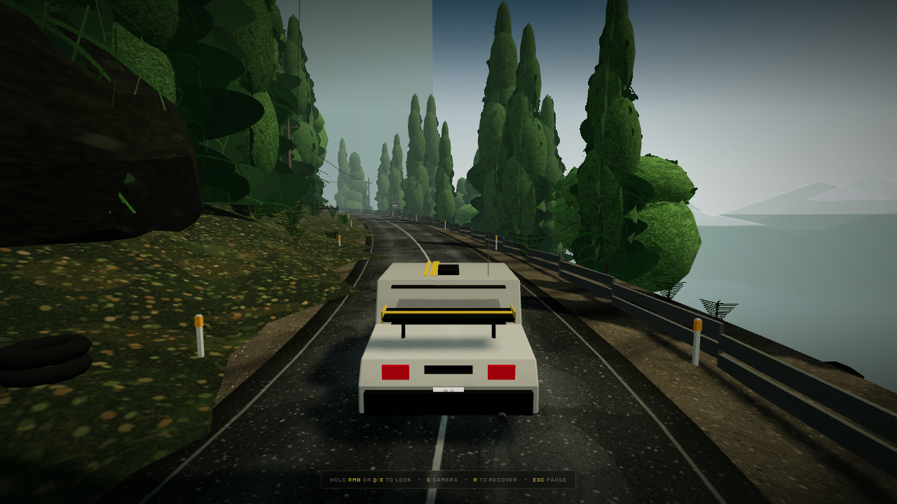

# GROUP B — RALLY LEGENDS

A 3D first-person Group B rally game built with Three.js and vanilla JavaScript. Six stages across six biomes plus an infinite, chunk-streamed ENDLESS mode, six period rally cars, a physical cockpit with a working trip-computer map, co-driver pacenotes, and a proper surface-aware driving model with direct, planted steering.


## Run it

ES modules need an HTTP server, so opening `index.html` directly will not work.

```bash
./run.sh
# or
python3 -m http.server 8080
```

Then open <http://localhost:8080/>. The game is desktop-first and supports keyboard or gamepad.

## The game

### Stages in six biomes
- **KIELDER** — a fast, blind-crested forest stage in Northumberland. Loose gravel and mud.
- **KURU-KURU** — a tight Central American jungle tunnel of wet mud, standing water and roots, with rain.
- **ROVANIEMI** — Lapland's snowbanks and sweepers, with glare ice and snowfall.
- **HONSHU TOUGE** — a narrow cedar-lined Japanese mountain pass. Wet asphalt, switchbacks, guardrails, retaining walls and mist.
- **URAL TAIGA** — wide, fast Russian trail through birch alleys. Cracked asphalt, long straights and blind crests.
- **GREAT RIFT** — a red-dirt Kenyan safari trail with acacia trees, big crests and open dust.

Every authored stage route is generated from a Catmull-Rom spline with its own geometry, terrain, tree/rock scatter, hazards, pacenotes and weather. ENDLESS routes use a dedicated forward-progressing procedural generator. No external models or textures are used.

### Biome generation
The six regions no longer share one generic forest. Each biome owns its terrain profile, road surface, tree and understory mix, roadside furniture, palette and atmosphere:
- **KIELDER** — rolling Northumberland banks, dense pine/oak canopy, ferns, stone walls and telegraph wires over loose gravel.
- **KURU-KURU** — steep jungle ridges, palms, banana leaves, hanging vines, reeds and standing water over wet mud.
- **ROVANIEMI** — open Lapland fells, wind-packed snow, drifts, exposed rock and sparse snow-laden spruce.
- **HONSHU TOUGE** — a genuine mountain shelf: a cliff/retaining wall on the uphill side, guardrail and valley drop on the other, cedar trunks and asphalt lane markings.
- **URAL TAIGA** — flat, wide taiga with white birch alleys, utility poles, dry grass and cracked asphalt.
- **GREAT RIFT** — open red-earth savannah with acacias, baobabs, dry grass, termite mounds and dust.




### ENDLESS mode
Pick any stage, flip the menu switch from **STAGE** to **ENDLESS**, and the road keeps generating ahead of you forever.

- A procedural route generator builds corners, hairpins, straights, elevation changes and crests from the selected region's own character (tight touge, fast taiga, open safari, icy Lapland, etc.).
- Road, terrain, shoulder, snow bank, scenery, posts and hazard surfaces are streamed in ~200 m chunks and the chunks behind you are disposed, so geometry and draw calls stay flat.
- Hazards, pacenotes and the co-driver keep being generated with the road. The trip-computer map switches to a live local section instead of trying to draw a shrinking whole route.
- The timer keeps running, there is no finish gantry, and your furthest distance is stored per stage and car. Quit from the pause menu when you have had enough.
- Streaming works on all six biomes, not just the new regions.

### Six Group B cars
| Car | Layout | Power | Weight | Character |
|---|---|---|---|---|
| Audi Quattro S1 E2 | AWD | 476 hp | 1090 kg | Heavy, planted, five-cylinder turbo |
| Lancia Delta S4 | AWD | 480 hp | 890 kg | Light, twin-charged, savage |
| Peugeot 205 T16 Evo 2 | AWD | 499 hp | 910 kg | Compact and agile |
| Ford RS200 | AWD | 450 hp | 1050 kg | Balanced mid-engine machine |
| Lancia 037 Rally | RWD | 325 hp | 960 kg | Supercharged, no safety net |
| Renault 5 Turbo 2 | RWD | 350 hp | 970 kg | Short-wheelbase pocket rocket |

### Cockpit and dash
- Four camera views — **cockpit**, bonnet, chase and bumper — cycled with **C**, the pad's **LB** or the on-screen **CAM** button.
- First-person driver's-eye view with a 3D co-driver sitting to your right.
- Holding the **right mouse button** (or right stick) lets you look around at him, the side windows and the cabin.
- A real center-dash **trip-computer screen** displays the stage map, car marker, timer, best time, gear/speed, surface, grip level, road status and radio state.
- A second physical **co-driver screen** shows large directional arrows, severity numbers, distance, "tightens/opens" modifiers, the next note, current surface/grip and upcoming hazards.
- Steering wheel, hands, gear lever and handbrake animate. The interior has a roll cage, harnesses, screens, wipers, mirrors and co-driver with helmet/headset.
- No floating map or timer HUD. The only overlay in normal driving is a small controls hint that fades away.


### Weather and time of day
Every stage can be run in any combination of conditions. Both are selectable from the menu strip or in Settings:

- **Weather** — clear, overcast, rain, storm, snow and fog. Each changes sky and fog colour, sun strength, surface grip, spray/dust, wipers, headlights and the wet sheen on the road. Storms add lightning flashes and thunder.
- **Time** — dawn, day, dusk and night. Dawn/dusk grade the palette warm and put the sun on the horizon; night brings stars, a moon, fireflies and working headlights with light pools on the road.
- **Auto** keeps each stage's authored default look; pick dawn, dusk or night for a different mood.

### Driving model
- Bicycle-style steering with a progressive lock, fast steering rack and a grip-limited yaw cap. Turn-in is direct, the car bites when you ask it to, and the front end no longer floats through long corners.
- Higher lateral tyre damping and a quicker yaw response keep the car planted, while a deliberate slip window still lets you move it around on the throttle and handbrake.
- Weight and power affect acceleration, braking and momentum; drivetrain layout gives different characteristics (AWD launch/neutrality, RWD throttle-oversteer, FWD understeer).
- Each car has its own grip figure and tyre package.
- Surface grip changes by biome and by hazard patches: loose gravel, mud, water, roots, black ice, deep snow, wet tarmac, moss, sand and fesh-fesh.
- Handbrake rotates the car but cuts lateral grip and scrubs speed.
- Turbo boost builds with lag; engine/induction/turbo audio follows the revs.
- The stage surface, ruts, snow banks, roadside markers and tree line affect the visual and physical route.
- Start/finish gantry posts are solid; the tree line is a hard corridor boundary.

### Pacenotes and co-driver
- Notes are generated from curvature, corner duration, tightening/opening rate, crests, jumps, straights and hazard patches.
- The co-driver calls notes as you approach them (toggle spoken voice in Settings).
- On-screen arrows and severity badges are drawn into the physical co-driver screen, with the road status/grip footer updating live.
- Radio activity is visualized on the screen, and the co-driver animates while calling.

### Vivid shaders
A custom post-processing stack is available in Settings under **Vivid shaders**:
- **VIVID** — gentle exposure lift, richer colour grade, bloom, sun haze, vignette, fine grain and chromatic edges.
- **CINEMATIC** — stronger contrast, teal shadows, warm highlights, heavier bloom and a filmic vignette.
- It is **off by default** and applies immediately from the Settings panel; normal rendering is untouched when it is off.

The stack is self-contained (`js/postfx.js`): a linear scene target, bright-pass bloom, separable blur and a final grading pass. It does not require an external post-processing package.

### Visual detail
- Sky dome with colour-managed gradient, sun/moon discs, horizon glow, drifting procedural cloud cover and a star field at night.
- Biome-specific distant ridges (jagged snow peaks, jungle ridges, flat taiga, rift escarpment), telegraph poles and sagging wires, tyre stacks and hay bales on the outside of corners, sponsor boards, hazard warning signs and parked spectator cars.
- Roads are individually textured: loose gravel ruts, mud and standing water, packed snow with ice, damp asphalt with painted lines, cracked Russian asphalt with potholes and red safari dirt.
- Skid marks are laid down under lock-up or handbrake slides; puddles and wet sheen appear when it rains.
- Windscreen rain droplets run and streak across the glass in the cockpit view.
- Snow/rain particles are kept out of the cabin, and spray colour follows the surface (dust, mud, snow).

### Timing
- Stage timer starts when the start lights go green and stops at the finish gantry.
- Personal bests are stored per stage and car in `localStorage`.
- ENDLESS runs store your furthest distance per stage and car instead of a stage time.
- Results show stage time, personal best, delta, a rank (S/A/B/C), and a "new stage record" flag.
- Recovery (`R`) returns the car to the road with a +3 second penalty.

### Settings
Graphics quality (high/medium/low), vivid shaders (off by default), weather, time of day, default camera, master volume, co-driver voice, weather effects, camera shake, look sensitivity, km/h or mph units, and clear-records. Quality affects draw distance/tree density, shadow quality and pixel ratio.

### Mobile
- Landscape touch layout: hold the left/right pads to steer, GAS/BRAKE pedals, handbrake, camera and pause buttons. Drag anywhere on the screen to look around.
- Rotate the phone to portrait and the game asks you to turn it back; the stage menu is re-laid out for short landscape screens.
- Touch devices default to medium quality once, then respect the saved setting. Fullscreen and landscape lock are requested when a stage starts.
- Everything else (stages, conditions, cars, audio) is the same as desktop.

## Controls

| Action | Keyboard | Gamepad | Touch |
|---|---|---|---|
| Throttle | W / ↑ | RT | GAS |
| Brake / reverse | S / ↓ | LT | BRAKE |
| Steer | A D / ← → | Left stick | ◀ ▶ pads |
| Handbrake | Space | A | HB |
| Look around | Hold right mouse / Q E | Right stick | Drag screen |
| Change camera | C | LB | CAM |
| Recover to road | R | Y | R |
| Pause | Esc | Start | II |
| Mute | M | Back | — |
| Controls briefing | H | — | — |

## Project layout

```
index.html            menu, overlays, import map
css/style.css         rally-poster UI, modals, responsive layout
js/main.js            renderer and loop
js/game.js            stage lifecycle, countdown, race loop, results
js/track.js           spline tracks, terrain, road/verges, biome scenery, pacenotes, endless chunk streaming
js/endlessRoute.js    procedural one-sample-at-a-time route generator
js/carModel.js        procedural cars, liveries, cockpit, co-driver, dash screens
js/physics.js         driving model and surface/collision handling
js/cockpit.js         CanvasTexture dash/map/pacenote renderers and animations
js/audio.js           procedural WebAudio engine/turbo/surface/impact + speech
js/weather.js         precipitation, spray, dust, fog banks, fireflies, lightning
js/effects.js         headlights and windscreen rain droplets
js/touch.js           landscape touch controls and rotate prompt
js/config.js          cars, stages, palettes, weather/time presets, storage
js/menuPreview.js     lit 3D showroom
js/ui.js              menu/car/stage cards, settings, pause, results
js/input.js           keyboard, mouse-look, gamepad
js/textures.js        procedural textures/liveries, bark, canopy, leaf and road surfaces
js/postfx.js          optional vivid/cinematic bloom and colour-grading shaders
js/util.js            math, noise, canvas, geometry helpers
vendor/three.module.js local Three.js build
assets/fonts/         local Barlow / Barlow Condensed / Share Tech Mono
docs/                 screenshots
```

## Notes & credits

- Three.js r160 (MIT) is vendored locally; see the header in `vendor/three.module.js`.
- Barlow, Barlow Condensed and Share Tech Mono are licensed under the SIL Open Font License and vendored under `assets/fonts/`.
- All other visuals, textures, geometry, tracks, car models and audio are generated procedurally in the browser. Trees, bark, leaf canopies, ground surfaces and road markings are all canvas-generated at load time.
- Save data lives in the browser's `localStorage` under the `gbr.*` keys.
- Built and tested with Chromium/WebGL2. `run.sh` will try to open your default browser automatically.


